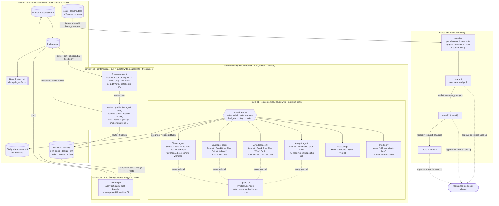

# Component view

What runs where, which tools each agent has, and who calls whom. Solid arrows are calls or
data flow; dashed arrows are what an agent may read. Nothing an agent runs holds a GitHub
credential: every GitHub write is made by deterministic Python (`gh` CLI), never by a model.

## Components

| Component | Kind | Runs in | Tools / rights | Calls |
|---|---|---|---|---|
| `autose.yml` | caller workflow | GitHub Actions | `permissions: {}` at top; each job widens only what it needs | gate job, then `autose-round.yml` up to 3 times |
| gate job | deterministic | `ubuntu-latest` | `issues: write` (reaction + status comment), API read of collaborator permission | decides start stage and issue number, writes `trigger.json` |
| `autose-round.yml` | reusable workflow | GitHub Actions | build → release → review jobs | `orchestrator.py`, `release.py`, reviewer + `review.py` |
| `orchestrator.py` | deterministic state machine (Python) | build job | `GITHUB_TOKEN` (issues: write) kept in its own process; spawns agents with a scrubbed environment | the four builder agents, the spec judge, `checks.py` |
| Analyst | Claude Code headless, `claude-sonnet-5-5` | build job | `Read Grep Glob Write`; Write only to `spec.md` | none |
| Architect | Claude Code headless, `claude-sonnet-5-5` | build job | `Read Grep Glob Write Bash`; Write only to `design.md`; Bash for read-only probes, tree reset afterwards | none |
| Developer | Claude Code headless, `claude-sonnet-5-5` | build job, head worktree | `Read Grep Glob Edit Write Bash`; edits only `markdown/**`, `docs/**`, `pyproject.toml`; no `git push/commit`, no network commands | none |
| Tester | Claude Code headless, `claude-sonnet-5-5` | build job, **base-commit** worktree | `Read Grep Glob Edit Write Bash`; edits only `tests/**` | none |
| Spec judge | Claude Code headless, `claude-haiku-5-5`, no tools, `--json-schema` | build job | none | none |
| `checks.py` | deterministic | build job | Python AST, `compileall`, `flake8`, `unittest` | none |
| `guard.py` | PreToolUse hook | every agent | denies tool calls outside the role's policy and logs them | none |
| `release.py` | deterministic | release job | short-lived GitHub App token (`autose-dev-avadiii`: contents + pull requests write, **no workflows permission**) | `git push`, `gh pr create/edit`, `gh pr checks` |
| Reviewer | Claude Code headless, `claude-sonnet-5-5` by default (ADR-012; Opus per run via `reviewer_model`; all recorded runs used Opus), `--json-schema` | review job (fresh VM) | `Read Grep Glob Bash`; no Edit/Write; environment has no GitHub token; `persist-credentials: false` | none |
| `review.py` (posting half) | deterministic | review job | `GITHUB_TOKEN` (pull-requests: write, issues: write for the status comment), used only after the reviewer process has exited | validates the verdict, posts the PR review, emits the route |

## Information each agent receives

| Agent | Gets | Deliberately does not get |
|---|---|---|
| Analyst | issue title + body, later comments by maintainers only (as untrusted data), repository (read), A1 skill | comments by non-maintainers, any GitHub token |
| Architect | `spec.md`, `ARCHITECTURE.md`, repository (read); in rework: test failures or reviewer findings tagged `design` | the raw issue text |
| Developer | `spec.md`, `design.md`, repository; on retry: failing test names + assertion output | the raw issue text, the tester's reasoning, the hidden tests |
| Tester | `spec.md`, `design.md` (interface), repository **at the base commit** | the implementation diff, the developer's reasoning |
| Reviewer | issue title + body, `git diff base...head`, repository at PR head; may run anything locally | `spec.md`, `design.md`, `test_report.md`, `pr.md`, every agent transcript |
